# Thor Arquivista - Caixa de Ferramentas de Preservação Digital

Aplicativo desktop em Python para executar tarefas comuns de preservação digital: manifestos BagIt, verificação de fixidez, geração de pacote BagIt, cópia validada, backup preservacional com manifestos por origem, análise/tratamento de duplicatas, exclusão de duplicatas por manifesto e conversão PREMIS.

O aplicativo usa Tkinter com `ttkbootstrap`, executa tarefas em fila local e grava o estado em arquivos JSON na própria pasta do projeto. A janela principal abre centralizada no monitor ativo.

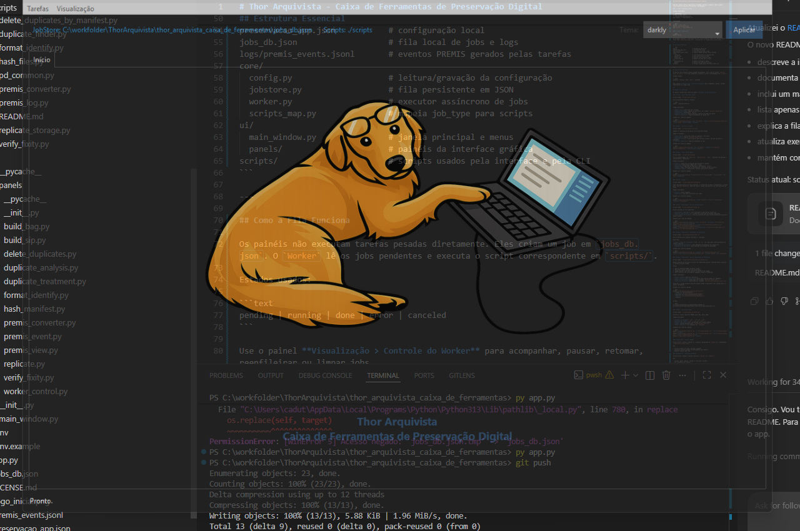

---

## Índice

- [Instalação Rápida](#instalação-rápida)
- [Estrutura Essencial](#estrutura-essencial)
- [Como a Fila Funciona](#como-a-fila-funciona)
- [Manual da Interface](#manual-da-interface)
- [Tarefas > Gerar Manifesto (Hash)](#tarefas--gerar-manifesto-hash)
- [Tarefas > Verificar Fixidez](#tarefas--verificar-fixidez)
- [Tarefas > Gerar Pacote BagIt](#tarefas--gerar-pacote-bagit)
- [Tarefas > Validar Pacote BagIt](#tarefas--validar-pacote-bagit)
- [Tarefas > Copiar](#tarefas--copiar)
- [Tarefas > Backup Preservacional](#tarefas--backup-preservacional)
- [Tarefas > Backup Incremental por Fixidez](#tarefas--backup-incremental-por-fixidez)
- [Tarefas > Editar Plano de Backup](#tarefas--editar-plano-de-backup)
- [Tarefas > Duplicatas > Análise de Duplicatas](#tarefas--duplicatas--análise-de-duplicatas)
- [Tarefas > Duplicatas > Tratamento de Duplicatas](#tarefas--duplicatas--tratamento-de-duplicatas)
- [Tarefas > Duplicatas > Excluir Duplicatas por Manifesto](#tarefas--duplicatas--excluir-duplicatas-por-manifesto)
- [Tarefas > Conversor Premis](#tarefas--conversor-premis)
- [Visualização > Eventos PREMIS](#visualização--eventos-premis)
- [Visualização > Controle do Worker](#visualização--controle-do-worker)
- [Scripts Disponíveis Pela Interface](#scripts-disponíveis-pela-interface)
- [Gerador de BAT para Windows](#gerador-de-bat-para-windows)
- [Testes](#testes)
- [Configuração](#configuração)
- [Boas Práticas](#boas-práticas)
- [Solução de Problemas](#solução-de-problemas)
- [Licença](#licença)

---

## Instalação Rápida

### 1. Baixar o projeto

Com Git:

```bash
git clone https://github.com/cadutd/ThorArquivista.git
cd ThorArquivista/thor_arquivista_caixa_de_ferramentas
```

Sem Git: baixe o ZIP do repositório no GitHub, extraia o arquivo e abra a pasta `thor_arquivista_caixa_de_ferramentas` no terminal.

### 2. Criar o ambiente Python

Windows PowerShell:

```powershell
python -m venv .venv
.\.venv\Scripts\Activate.ps1
pip install -r requirements.txt
```

Linux/macOS:

```bash
python -m venv .venv
source .venv/bin/activate
pip install -r requirements.txt
```

### 3. Rodar a aplicação

```bash
python app.py
```

Na primeira execução, o aplicativo usa ou cria os arquivos locais de configuração e fila, como `preservacao_app.json`, `jobs_db.json` e `logs/premis_events.jsonl`.

### 4. Gerar execução por BAT no Windows

Para criar um arquivo `.bat` de inicialização na raiz do projeto:

```powershell
python gerador_bat.py
```

O comando gera:

- `executar_thor_arquivista.bat`: executa `app.py`, usando `.venv\Scripts\python.exe` quando o ambiente virtual existir, ou `python` do sistema como fallback.
- `Thor Arquivista.lnk`: atalho do Windows apontando para o `.bat` e usando o ícone `icons/favicon.ico`.

Arquivos `.bat` não armazenam ícone próprio no Windows; por isso o ícone é aplicado ao atalho `.lnk`.

---

## Estrutura Essencial

```text
app.py                         # entrada da aplicação
gerador_bat.py                 # gera o .bat e o atalho .lnk para Windows
preservacao_app.json           # configuração local
jobs_db.json                   # fila local de jobs e logs
logs/premis_events.jsonl       # eventos PREMIS gerados pelas tarefas
icons/favicon.ico              # ícone usado pelo atalho gerado
core/
  config.py                    # leitura/gravação da configuração
  jobstore.py                  # fila persistente em JSON
  worker.py                    # executor assíncrono de jobs
  scripts_map.py               # mapeia job_type para scripts
ui/
  main_window.py               # janela principal e menus
  panels/                      # painéis da interface gráfica
scripts/                       # scripts usados pela interface e pela CLI
tests/                         # testes automatizados e relatório HTML
```

---


## Como a Fila Funciona

Os painéis não executam tarefas pesadas diretamente. Eles criam um job em `jobs_db.json`. O `Worker` lê os jobs pendentes e executa o script correspondente em `scripts/`.

Estados usados:

```text
pending | running | done | error | canceled
```

Use o painel **Visualização > Controle do Worker** para acompanhar, pausar, retomar, reenfileirar ou limpar jobs. A lista abre com o filtro **todos** por padrão.

Para reduzir travamentos em execuções longas, o Worker agrupa linhas de log antes de gravar em `jobs_db.json`, usa escrita atômica com arquivos temporários únicos e limita o histórico mantido por job. A janela de logs atualiza incrementalmente, em vez de reconstruir todo o conteúdo a cada atualização.

---

## Manual da Interface

Os painéis disponíveis ficam nos menus **Tarefas** e **Visualização**.

### Tarefas > Gerar Manifesto (Hash)

Script usado: `scripts/hash_files.py`

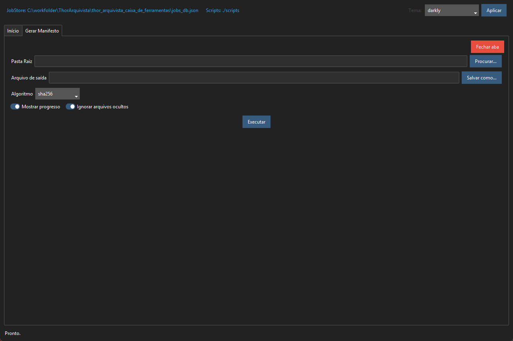

Gera um manifesto BagIt no formato:

```text
<hash>  <caminho/relativo>
```

Campos principais:

- **Pasta raiz**: pasta que será varrida.
- **Arquivo de saída**: caminho do manifesto, por exemplo `manifest-sha256.txt`.
- **Algoritmo**: normalmente `sha256`.
- **Ignorar ocultos**: ignora arquivos e pastas iniciados por ponto. A opção abre desmarcada por padrão.
- **Mostrar progresso**: registra andamento no log do job em marcos de 5%, com quantidade processada e restante.

Exemplo por linha de comando:

```bash
python scripts/hash_files.py --raiz "D:/acervo" --saida "D:/acervo/manifest-sha256.txt" --algo sha256 --ignore-hidden --progress
```

### Tarefas > Verificar Fixidez

Script usado: `scripts/verify_fixity.py`

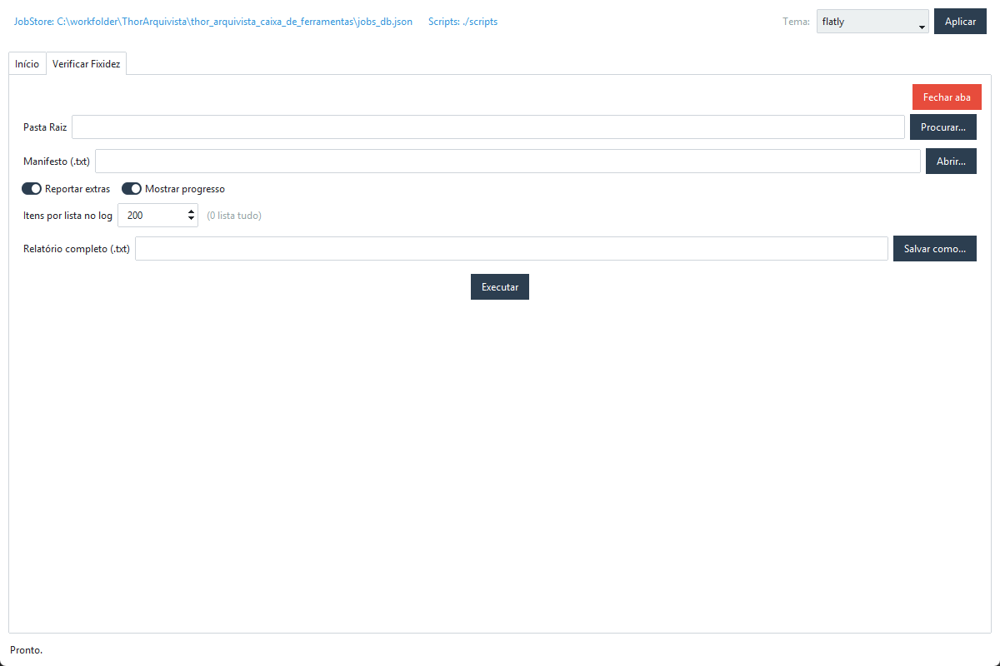

Compara os arquivos de uma pasta com um manifesto BagIt.

Campos principais:

- **Pasta raiz**: pasta onde estão os arquivos a verificar.
- **Manifesto**: arquivo `manifest-<algo>.txt`.
- **Reportar extras**: mantido por compatibilidade; o relatório final sempre lista arquivos que existem na pasta, mas não aparecem no manifesto.
- **Mostrar progresso**: registra andamento no log em marcos de 5%, com quantidade verificada e restante.
- **Itens por lista no log**: limita quantos caminhos aparecem em cada lista no log do Worker; use `0` para listar tudo.
- **Relatório completo**: caminho opcional para gravar o TXT completo. Se ficar vazio, o script cria o arquivo automaticamente ao lado do manifesto.

Relatório final:

- total de entradas no manifesto;
- quantidade de arquivos verificados íntegros;
- quantidade de arquivos corrompidos, com hash diferente do manifesto;
- quantidade de erros de acesso ou leitura, separada dos corrompidos;
- quantidade e lista de arquivos presentes no manifesto e ausentes na pasta analisada;
- quantidade e lista de arquivos presentes na pasta analisada e ausentes no manifesto;
- tempo total de verificação e média por arquivo.

No Windows, a verificação usa caminhos estendidos para acessar caminhos completos longos, inclusive em compartilhamentos de rede UNC. Informe a pasta normalmente, como `\\servidor\compartilhamento\acervo`; a conversão é automática nas operações de leitura e enumeração.

Falhas transitórias de leitura ou rede têm até três tentativas, com intervalos de 0,25 e 0,5 segundo. Cada nova tentativa recalcula o hash desde o início. Arquivos só recebem `MISSING` após o sistema informar ausência e a raiz continuar acessível; falhas de permissão, caminhos inválidos e erros de rede identificados ficam como `ERROR`. O detalhe registra o erro original, o caminho completo e seu comprimento.

Se a busca por extras falhar após as tentativas aplicáveis, o relatório indica **Busca de extras: incompleta**. Nesse caso, a contagem de extras não é conclusiva e a execução retorna código `1`.

As contagens e seções são exibidas mesmo quando o valor é `0`; listas vazias aparecem como `Nenhum`.

Para evitar travamentos e excesso de escrita em disco, listas grandes são compactadas no log do Worker. A execução grava um relatório TXT completo e informa o caminho no log. Esse TXT inclui uma seção estruturada em TSV, com `status`, `path`, `expected_hash`, `actual_hash` e `detail`, usada pelo backup incremental por fixidez.

Quando a execução encontra divergências de fixidez, o Worker registra **Concluído com divergências de fixidez** em vez de tratar o caso como falha operacional do script.

Exemplo por linha de comando:

```bash
python scripts/verify_fixity.py --raiz "D:/acervo" --manifesto "D:/acervo/manifest-sha256.txt" --report-extras --progress
```

Exemplo de log compacto no Worker:

```text
[INFO] Arquivos a verificar: 30860 (algo=sha256)
[INFO] Iniciando verificação de arquivos...
[INFO] Progresso 5%: verificados 1543/30860; faltam 29317
[INFO] Progresso 100%: verificados 30860/30860; faltam 0
[INFO] Verificação finalizada: 30860 arquivo(s) verificado(s) em 2364.43s; média 0.0766s/arquivo
[INFO] Procurando arquivos extras em disco...
[stdout] (relatório final)
=== Verificação de fixidez ===
Total no manifesto: 30860
Arquivos verificados íntegros: 28363
Arquivos verificados corrompidos: 0
Erros de acesso ou leitura: 0
Arquivos no manifesto ausentes na pasta analisada: 2497
Arquivos na pasta analisada ausentes no manifesto: 0
Busca de extras: concluída
...
Relatório completo: D:\acervo\verify_fixity_report_20260801T221817Z.txt
[WARN] Concluído com divergências de fixidez
```

Exemplo da seção estruturada gravada no relatório TXT:

```text
=== Dados estruturados para backup incremental ===
# Formato: TSV
# Registros OK são omitidos para reduzir o tamanho do relatório.
# Colunas: status	path	expected_hash	actual_hash	detail
status	path	expected_hash	actual_hash	detail
MISSING	data/foto.jpg	3a6eb079...		Arquivo listado no manifesto ausente na pasta analisada
CORRUPT	data/video.mp4	2cf24dba...	b94d27b9...	Hash gerado diferente do hash no manifesto
ERROR	data/restrito.tif	3a6eb079...		Erro de acesso; caminho completo e comprimento registrados no detalhe
EXTRA	data/novo.tif			Arquivo presente na pasta analisada e ausente no manifesto
SCAN_ERROR	.			Busca de extras incompleta: erro de acesso ao diretório
```

### Tarefas > Gerar Pacote BagIt

Script usado: `scripts/build_bag.py`

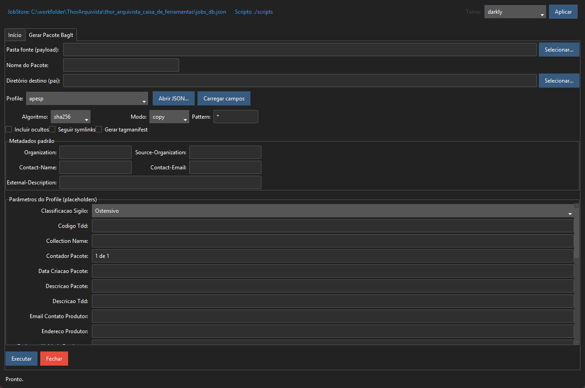

Cria um pacote BagIt com `bagit.txt`, `bag-info.txt`, `data/`, manifesto do payload e, opcionalmente, tagmanifest.

Campos principais:

- **Fonte**: pasta com os arquivos que entrarão no pacote.
- **Destino**: pasta onde o BagIt será criado.
- **Algoritmo**: algoritmo do manifesto, normalmente `sha256`.
- **Modo**: cópia, hardlink ou movimentação, conforme opções do painel.
- **Metadados BagIt**: organização, contato, descrição e profile.

Exemplo por linha de comando:

```bash
python scripts/build_bag.py "D:/acervo/fonte" "D:/bags/bag_001" --algo sha256 --mode copy --tagmanifest
```

Durante a transferência e a geração do manifesto do payload, o progresso é registrado em marcos de 5%, com resumo de tempo total e média por arquivo ao final de cada fase.

### Tarefas > Validar Pacote BagIt

Script usado: `scripts/validate_bag.py`

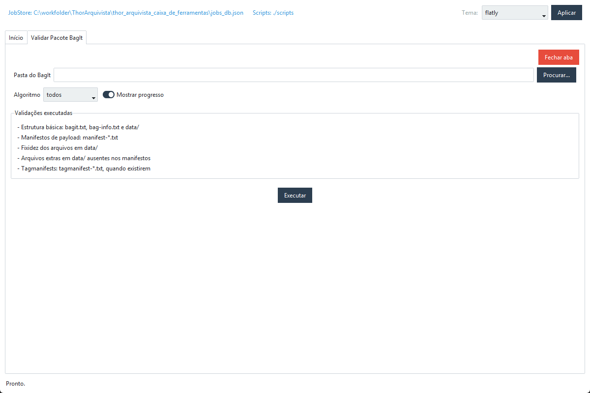

Valida pacotes BagIt criados pela funcionalidade **Gerar Pacote BagIt**. A rotina confere a estrutura básica, os manifestos do payload, os arquivos em `data/` e os `tagmanifest-*` quando existirem.

Campos principais:

- **Pasta do BagIt**: pasta raiz do pacote, contendo `bagit.txt`, `bag-info.txt` e `data/`.
- **Algoritmo**: permite validar todos os manifestos encontrados ou restringir a um algoritmo específico.
- **Mostrar progresso**: registra andamento no log do job em marcos de 5%, com quantidade verificada e restante.

Exemplo por linha de comando:

```bash
python scripts/validate_bag.py "D:/bags/bag_001" --progress
```

O relatório final informa se o pacote é **VÁLIDO** ou **INVÁLIDO**, quantos arquivos de payload e de tag foram verificados, além das listas de ausentes, corrompidos e extras em `data/`.

### Tarefas > Copiar

Script usado: `scripts/replicate_storage.py`

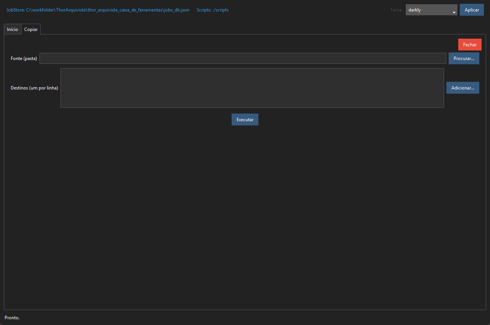

Copia uma pasta para um ou mais destinos. A verificação de hash é obrigatória: o script gera `manifest-sha256.txt` antes da cópia e valida cada destino com esse manifesto ao final.

Campos principais:

- **Fonte**: pasta original.
- **Destinos**: uma pasta de destino por linha.

Exemplo por linha de comando:

```bash
python scripts/replicate_storage.py --fonte "D:/acervo" --destino "E:/backup_1" --destino "F:/backup_2"
```

O progresso da cópia, da geração do manifesto e da verificação de fixidez é registrado em marcos de 5%, sem atualização contínua no terminal.

### Tarefas > Backup Preservacional

Script usado: `scripts/backup_plan.py`

Executa um backup preservacional incremental com uma pasta de arquivos para cada origem e controle centralizado em `thor-backup/`. Cada origem possui seu próprio `manifest-<algoritmo>.txt`, com caminhos relativos à pasta correspondente no destino. Esses manifestos são a fonte de verdade do incremental; nenhum banco SQL é usado.

Campos e ações principais:

- **Plano JSON**: define nome, destino, opções e origens.
- **Destino do backup**: pasta usada pelas ações de pausa, verificação e histórico. A execução usa o destino definido no JSON.
- **Backup**: nome usado para localizar o checkpoint no histórico. A execução usa o nome definido no JSON.
- **Validar plano**: confere a estrutura mínima, os nomes e caminhos das origens, informa origens ausentes e mostra as pastas e manifestos previstos no destino.
- **Executar**: enfileira `BACKUP_PLAN`.
- **Retomar**: enfileira a retomada de uma execução interrompida, removendo `STOP` no destino do plano. O checkpoint deve corresponder à estrutura, algoritmo e origens do plano.
- **Pausar com STOP**: cria `thor-backup/checkpoints/STOP`.
- **Verificar integridade**: enfileira `BACKUP_VERIFY`, que encontra os manifestos por origem e identifica seus algoritmos automaticamente.
- **Histórico**: lista checkpoints, relatórios, manifestos atuais e históricos.

Funcionamento do incremental:

- O campo `name` de cada origem define sua pasta no destino, após normalização dos caracteres do nome.
- Arquivos novos e alterados são copiados para `<destino>/<origem>/`, preservando subpastas e conferindo o hash após a cópia.
- A versão anterior de um arquivo alterado é movida para `thor-backup/versoes/<execucao>/<origem>/`.
- Arquivos removidos da origem permanecem no destino e no respectivo manifesto, com a ocorrência registrada no relatório.
- Arquivos iguais são identificados comparando o hash da origem com o manifesto do destino. Seu conteúdo no destino não é verificado novamente durante o incremental; use **Verificar integridade** para detectar ausência ou corrupção.
- Cada execução concluída guarda cópias dos manifestos em `thor-backup/historico/<execucao>/<origem>/`, além de `alteracoes.json` e relatório TXT.
- Os manifestos são gravados em arquivo temporário e substituídos após a escrita.

`thor-backup` é um nome reservado. Nomes de origem que colidam após normalização, inclusive diferenças apenas de maiúsculas e minúsculas, são recusados. Origem e destino não podem estar contidos um no outro. Destinos da estrutura anterior não são convertidos automaticamente: escolha um novo destino para iniciar nesse formato, mantendo o backup existente preservado.

O marcador `STOP` é consultado após cada arquivo processado, inclusive os classificados como iguais. A rotina salva os manifestos e o checkpoint e encerra como `PAUSED`. A geração dos manifestos de origem não é interrompida por `STOP`. Pela linha de comando, remova o marcador antes de usar `--resume`; a interface faz essa remoção no botão **Retomar**.

Com `--progress` (ativado pela interface), a geração dos manifestos de origem e a aplicação incremental registram progresso em marcos de 5%, quantidade restante e duração.

Exemplos por linha de comando:

```bash
python scripts/backup_plan.py --config "D:/planos/backup.json" --progress
python scripts/backup_plan.py --resume --config "D:/planos/backup.json"
python scripts/backup_verify.py --destino "E:/Backup" --progress
# Filtrar a verificação por algoritmo e registrar PREMIS:
python scripts/backup_verify.py --destino "E:/Backup" --algo sha512 --premis-log "E:/Backup/thor-backup/logs/premis_events.jsonl" --progress
```

Na execução direta, `backup_plan.py` registra PREMIS em `thor-backup/logs/premis_events.jsonl` por padrão; `--premis-log` altera o caminho. `backup_verify.py` registra um `FIXITY_CHECK` por manifesto somente quando recebe `--premis-log`. Pela interface, o Worker fornece o log PREMIS configurado na aplicação para as duas rotinas. Os relatórios da verificação ficam em `thor-backup/relatorios/verificacao_<execucao>/`, fora das pastas de arquivos das origens.

Estrutura para um plano com origens `documentos` e `imagens`, usando SHA-256:

```text
Backup/
  documentos/
    documento.pdf
    contratos/contrato.pdf
  imagens/
    fotografia.jpg
  thor-backup/
    configs/acervo_institucional_<execucao>.json
    manifests/
      documentos/manifest-sha256.txt
      imagens/manifest-sha256.txt
    historico/<execucao>/
      documentos/manifest-sha256.txt
      imagens/manifest-sha256.txt
      alteracoes.json
    checkpoints/acervo_institucional.state.json
    relatorios/acervo_institucional_<execucao>_relatorio.txt
    logs/premis_events.jsonl
    versoes/
```

Os arquivos do acervo mostrados acima são exemplos. O manifesto de `documentos` contém caminhos relativos a `Backup/documentos/`, sem incluir o nome da origem:

```text
<hash_sha256>  documento.pdf
<hash_sha256>  contratos/contrato.pdf
```

O algoritmo padrão é `sha256`; para `sha512` ou `md5`, o nome do manifesto acompanha o algoritmo. `ignore_hidden` exclui nomes iniciados por ponto; `follow_symlinks: false` ignora links simbólicos. No primeiro backup para um destino vazio, `versoes/` fica vazia.

Relatório final:

O relatório TXT em UTF-8 segue a organização da verificação de fixidez: identificação da execução, origens e manifestos, contagens, listas detalhadas por resultado e resumo final. Cada registro apresenta o caminho do arquivo e, quando disponíveis, origem, destino, hashes completos e detalhes da versão preservada. Seções vazias mostram `Nenhum`.

Exemplo do resumo apresentado no log do Worker:

```text
=== Resumo final do backup ===
Total de arquivos no relatório: 4
Arquivos novos copiados: 1
Arquivos alterados copiados: 1
Cópias com hash conferido: 2
Arquivos iguais ao manifesto (sem nova cópia): 1
Arquivos ausentes na origem e preservados no destino: 1
Arquivos com falha: 0
Tempo total de execução: 12.34s
Relatório completo: E:/Backup/thor-backup/relatorios/acervo_institucional_<execucao>_relatorio.txt
```

As listas completas ficam no TXT, sem ampliar o log do Worker com todos os arquivos. As contagens descrevem a execução atual; em uma retomada, arquivos copiados antes da pausa podem aparecer como iguais. O relatório final é emitido ao concluir o backup.

Veja o [exemplo completo do relatório e as opções dos scripts](scripts/README.md#backup_planpy). Os relatórios CSV de execuções anteriores continuam disponíveis no histórico; novas execuções geram o TXT.

### Tarefas > Backup Incremental por Fixidez

Script usado: `scripts/incremental_backup_from_fixity.py`

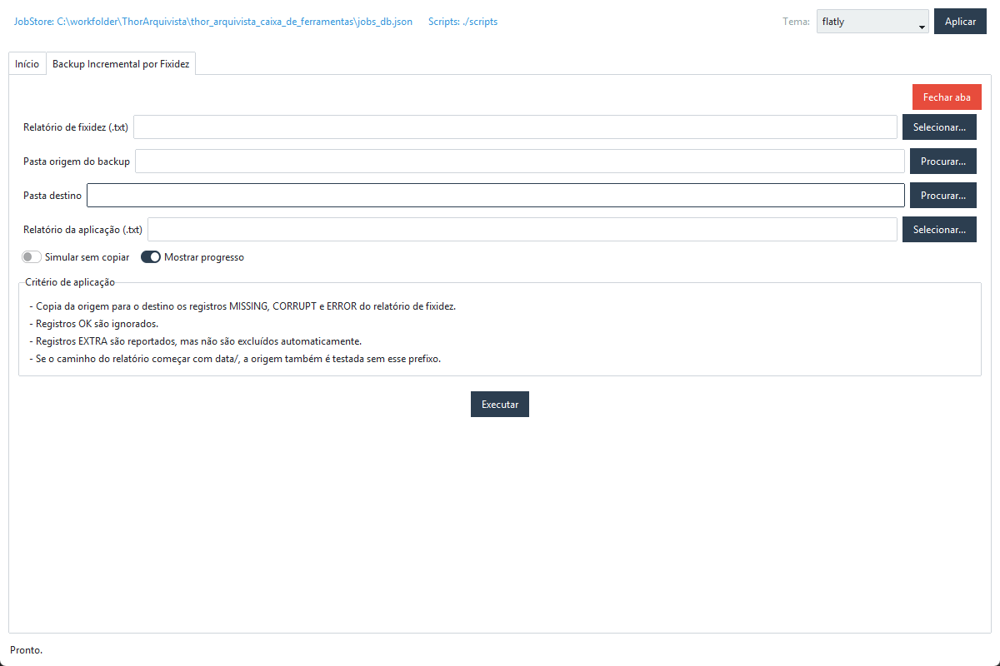

Aplica um backup incremental usando como entrada o relatório TXT estruturado gerado por **Verificar Fixidez**. A rotina copia da origem para o destino apenas os registros com status `MISSING`, `CORRUPT` ou `ERROR`.
Registros `OK` não são gravados nos relatórios novos de fixidez para reduzir o tamanho do arquivo; relatórios antigos que ainda contenham `OK` continuam sendo aceitos e esses registros são ignorados.

Campos principais:

- **Relatório de fixidez**: TXT emitido por `verify_fixity.py`, contendo a seção `Dados estruturados para backup incremental`.
- **Pasta origem do backup**: pasta com os arquivos íntegros que serão usados para recompor o destino.
- **Pasta destino**: pasta que será atualizada.
- **Relatório da aplicação**: TXT opcional com o resultado do incremental.
- **Simular sem copiar**: executa a análise e gera relatório sem alterar o destino.
- **Mostrar progresso**: registra andamento em marcos de 5%.

Regras por status:

- `OK`: ignorado.
- `MISSING`: copia da origem para o destino.
- `CORRUPT`: substitui no destino pelo arquivo da origem.
- `ERROR`: tenta copiar novamente da origem.
- `EXTRA`: reportado, mas não excluído automaticamente.
- `SCAN_ERROR`: falha na enumeração de diretórios; ignorado pelo incremental, pois não representa um arquivo a copiar. Corrija o acesso e execute novamente a verificação para obter a relação completa de extras.

Exemplo por linha de comando:

```bash
python scripts/incremental_backup_from_fixity.py --relatorio-fixidez "D:/acervo/verify_fixity_report.txt" --origem "D:/origem" --destino "E:/backup" --progress
```

Exemplo de saída:

```text
=== Backup incremental por relatório de fixidez ===
Registros lidos: 4
Registros OK ignorados: 0
Registros EXTRA ignorados: 1
Arquivos candidatos a copiar: 3
Arquivos copiados: 3
Arquivos ausentes na origem: 0
Caminhos inválidos no relatório: 0
Falhas de cópia: 0
```

### Tarefas > Editar Plano de Backup

Tela separada para criar e editar o arquivo JSON usado pelo backup preservacional.

Funcionalidades:

- criar plano novo;
- abrir plano existente;
- editar nome do backup, destino BagIt, algoritmo e opções;
- adicionar, editar e remover origens;
- pré-visualizar JSON;
- validar campos obrigatórios;
- salvar ou salvar como `.json`.

Exemplo de plano:

```json
{
  "name": "acervo_institucional",
  "destination": "E:/Backup",
  "sources": [
    {"name": "documentos", "path": "D:/Acervo/Documentos"},
    {"name": "imagens", "path": "D:/Acervo/Imagens"}
  ],
  "options": {
    "algo": "sha256",
    "ignore_hidden": true,
    "follow_symlinks": false
  }
}
```

### Tarefas > Duplicatas > Análise de Duplicatas

Script usado: `scripts/duplicate_finder.py`

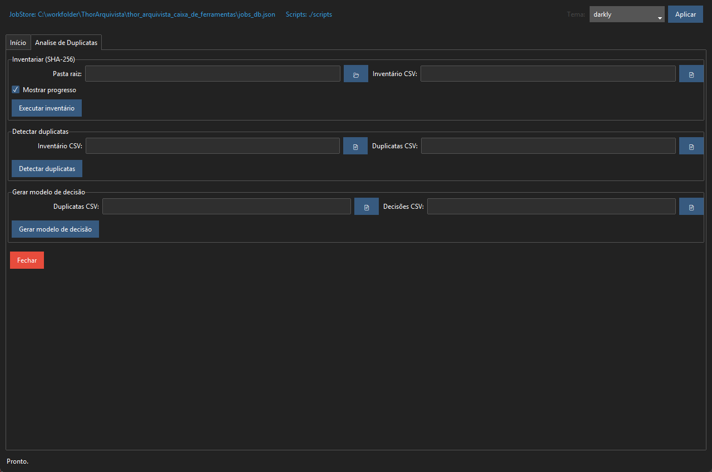

Painel dividido em três operações:

- **Inventariar (SHA-256)**: varre uma pasta e gera CSV de inventário.
- **Detectar duplicatas**: lê o inventário e gera CSV com grupos duplicados.
- **Gerar modelo de decisão**: cria uma planilha CSV para revisão humana dos arquivos a manter/remover.

Exemplos por linha de comando:

```bash
python scripts/duplicate_finder.py --raiz "D:/acervo" --inventario "D:/relatorios/inventario.csv" --mostrar-progresso
python scripts/duplicate_finder.py --inventario "D:/relatorios/inventario.csv" --duplicatas "D:/relatorios/duplicatas.csv"
python scripts/duplicate_finder.py --from-duplicatas "D:/relatorios/duplicatas.csv" --decisoes "D:/relatorios/decisoes.csv"
```

Quando **Mostrar progresso** está habilitado, o inventário registra total inicial, marcos de 5%, quantidade restante e resumo de duração.

### Tarefas > Duplicatas > Tratamento de Duplicatas

Script usado: `scripts/duplicate_finder.py`

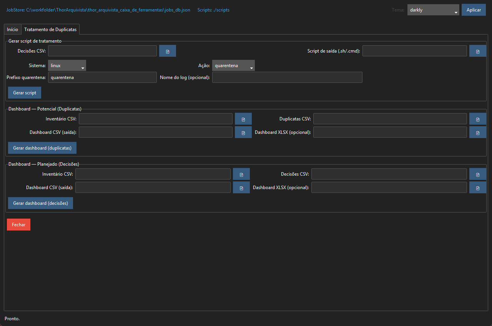

Gera artefatos para executar decisões já revisadas.

Operações:

- **Gerar script de tratamento**: cria `.sh` ou `.cmd` para mover para quarentena ou remover arquivos.
- **Dashboard de duplicatas**: gera CSV/XLSX com potencial de recuperação.
- **Dashboard de decisões**: gera CSV/XLSX com recuperação planejada.

Exemplo por linha de comando:

```bash
python scripts/duplicate_finder.py --decisoes "D:/relatorios/decisoes.csv" --gerar-script-remocao "D:/relatorios/tratar.cmd" --sistema windows --acao quarentena
```

### Tarefas > Duplicatas > Excluir Duplicatas por Manifesto

Script usado: `scripts/delete_duplicates_by_manifest.py`

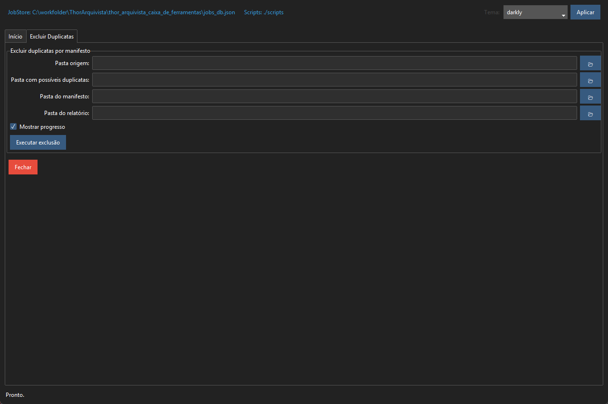

Remove arquivos de uma pasta de possíveis duplicatas quando o SHA-256 desses arquivos já existe na pasta origem.

Fluxo:

1. Gera um manifesto BagIt da pasta origem.
2. Percorre a pasta com possíveis duplicatas.
3. Apaga arquivos cujo hash aparece no manifesto da origem.
4. Gera relatório CSV com arquivos apagados e espaço recuperado.

Com progresso habilitado, a geração do manifesto e a verificação/exclusão também usam marcos de 5% e resumo de duração.

Campos principais:

- **Pasta origem**: pasta de referência.
- **Pasta com possíveis duplicatas**: pasta onde arquivos podem ser apagados.
- **Pasta do manifesto**: pasta onde será gravado `manifest-sha256.txt`.
- **Pasta do relatório**: pasta onde será gravado `relatorio_exclusao_duplicatas.csv`.

Proteção: o script bloqueia execução quando origem e duplicatas são a mesma pasta ou pastas sobrepostas.

Exemplo por linha de comando:

```bash
python scripts/delete_duplicates_by_manifest.py \
  --origem "D:/acervo/originais" \
  --duplicatas "D:/acervo/possiveis_duplicatas" \
  --manifesto "D:/relatorios/manifesto_origem" \
  --relatorio "D:/relatorios/exclusao_duplicatas" \
  --progress
```

Saídas:

```text
D:/relatorios/manifesto_origem/manifest-sha256.txt
D:/relatorios/exclusao_duplicatas/relatorio_exclusao_duplicatas.csv
```

### Tarefas > Conversor Premis

Script usado: `scripts/premis_converter.py`

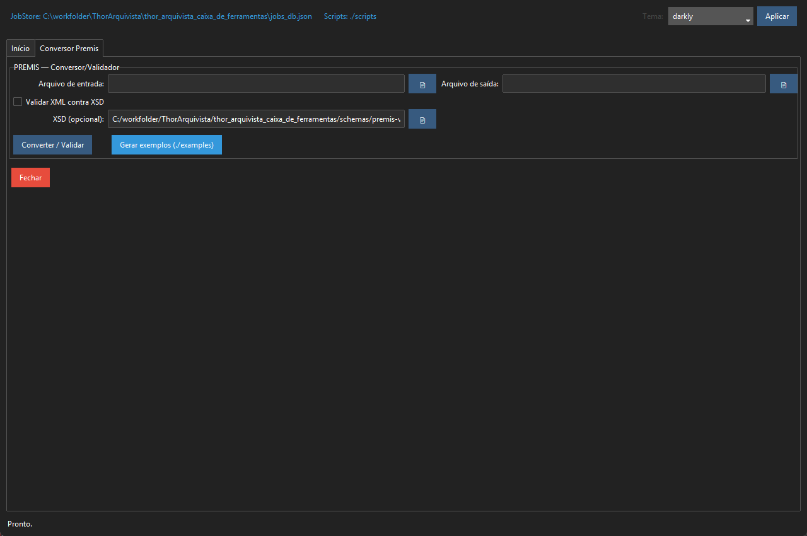

Converte e valida registros PREMIS entre XML, CSV e JSON.

Campos principais:

- **Arquivo de entrada**: `.xml`, `.csv` ou `.json`.
- **Arquivo de saída**: `.xml`, `.csv` ou `.json`.
- **Validar XML contra XSD**: valida XML com o schema PREMIS.
- **XSD**: caminho opcional para `schemas/premis-v3-0.xsd`.
- **Gerar exemplos**: cria exemplos em `./examples`.

Exemplos por linha de comando:

```bash
python scripts/premis_converter.py --in "D:/premis/premis.xml" --out "D:/premis/premis.csv" --validate
python scripts/premis_converter.py --in "D:/premis/premis.csv" --out "D:/premis/premis.xml" --schema "schemas/premis-v3-0.xsd"
python scripts/premis_converter.py --example
```

### Visualização > Eventos PREMIS

Script direto: nenhum. O painel lê o arquivo configurado em `premis_log`, normalmente `logs/premis_events.jsonl`.

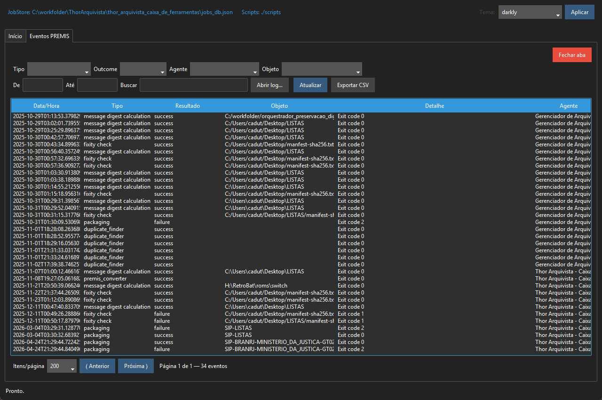

Uso:

- filtrar eventos por tipo, período e agente;
- consultar eventos gerados automaticamente pelo Worker;
- exportar eventos para CSV.

### Visualização > Controle do Worker

Script direto: nenhum. O painel controla o `Worker` e o `JobStore`.

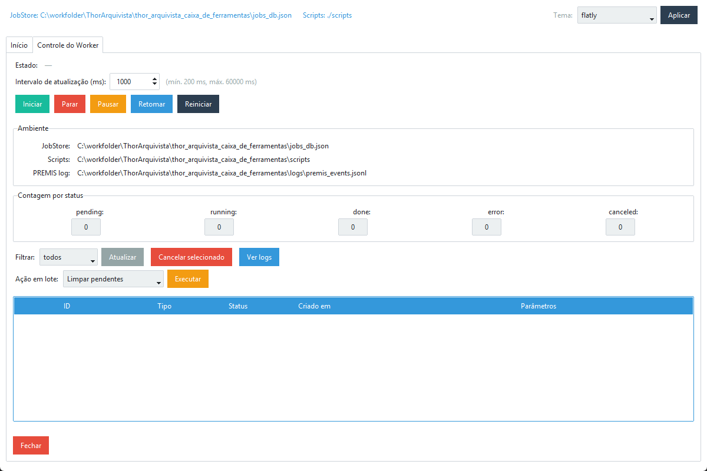

Uso:

- iniciar, parar, pausar, retomar e reiniciar o worker;
- ver contadores por status;
- listar jobs por status; o filtro inicial é **todos**;
- cancelar jobs pendentes;
- executar ações em lote por seletor, como reenfileirar jobs com erro, reenfileirar todos e limpar jobs por status;
- limpar jobs pendentes, em execução, concluídos, com erro ou cancelados;
- abrir logs detalhados de cada job;
- copiar logs para a área de transferência;
- exportar o conteúdo atual da janela de logs para um arquivo `.txt`.

A janela de logs faz auto-refresh incremental e usa intervalo mínimo de 5 segundos para reduzir leitura de disco e evitar travamentos em execuções longas.

Ao tentar fechar o sistema, se houver job em execução, a janela principal mostra uma confirmação de encerramento com o tipo e o id do job em processamento.

---

## Scripts Disponíveis Pela Interface

A interface gráfica usa estes scripts:

| Painel | Script |
|---|---|
| Gerar Manifesto (Hash) | `scripts/hash_files.py` |
| Verificar Fixidez | `scripts/verify_fixity.py` |
| Gerar Pacote BagIt | `scripts/build_bag.py` |
| Validar Pacote BagIt | `scripts/validate_bag.py` |
| Copiar | `scripts/replicate_storage.py` |
| Backup Preservacional | `scripts/backup_plan.py` |
| Backup Incremental por Fixidez | `scripts/incremental_backup_from_fixity.py` |
| Backup Preservacional > Verificar integridade | `scripts/backup_verify.py` |
| Editar Plano de Backup | nenhum script direto; cria/edita JSON |
| Análise de Duplicatas | `scripts/duplicate_finder.py` |
| Tratamento de Duplicatas | `scripts/duplicate_finder.py` |
| Excluir Duplicatas por Manifesto | `scripts/delete_duplicates_by_manifest.py` |
| Conversor Premis | `scripts/premis_converter.py` |

Outros scripts ou módulos podem existir no repositório como suporte interno, legado ou desenvolvimento, mas este README documenta apenas o que aparece na interface gráfica atual.

---

## Gerador de BAT para Windows

O arquivo `gerador_bat.py`, localizado na raiz do projeto, cria uma entrada de execução para Windows:

```powershell
python gerador_bat.py
```

Por padrão, ele grava `executar_thor_arquivista.bat` e `Thor Arquivista.lnk` na raiz. O `.bat` muda o diretório de trabalho para a pasta do projeto, procura primeiro por `.venv\Scripts\python.exe` e executa `app.py`. O atalho `.lnk` usa `icons/favicon.ico` como ícone.

Opções disponíveis:

```powershell
python gerador_bat.py --bat iniciar.bat --atalho "Thor Arquivista.lnk"
python gerador_bat.py --sem-atalho
```

Use `--sem-atalho` quando quiser gerar apenas o `.bat`. Sem o atalho, o arquivo `.bat` continua funcional, mas não exibe o ícone personalizado no Explorer.

---

## Testes

A suíte de testes cobre:

- criação e edição do plano JSON de backup;
- montagem das telas de Backup Preservacional e Editar Plano de Backup com widgets simulados;
- geração de manifestos;
- comparação `new`, `changed`, `same` e `removed`;
- execução inicial e incremental do backup;
- versionamento;
- preservação de removidos;
- parada segura por `STOP` e retomada;
- verificação de fixidez, relatório final de íntegros/corrompidos/faltantes/extras e evento PREMIS `FIXITY_CHECK`;
- caminhos longos com acentos no Windows, novas tentativas de leitura, distinção entre ausência e erro de acesso, e falha na busca por extras;
- concorrência e contenção de logs do `JobStore`.

Execute a suíte e gere o relatório HTML:

```powershell
py tests\run_backup_tests_html.py
```

Saída principal:

```text
tests/reports/backup_tests_report.html
```

O relatório lista cada teste executado com finalidade, pré-condições, pós-condições, status, duração e detalhes.

Para executar apenas os testes de caminhos longos e falhas de acesso da verificação de fixidez:

```powershell
python -m unittest discover -s tests -p test_verify_fixity.py -v
```

---

## Configuração

Arquivo principal: `preservacao_app.json`.

Exemplo:

```json
{
  "scripts_dir": "./scripts",
  "logs_dir": "./logs",
  "premis_log": "./logs/premis_events.jsonl",
  "premis_agent": "Thor Arquivista - Caixa de Ferramentas de Preservação Digital v1.0",
  "jobstore_path": "./jobs_db.json",
  "ui_theme": "flatly"
}
```

Campos:

- `scripts_dir`: pasta dos scripts chamados pelo Worker.
- `logs_dir`: pasta padrão de logs.
- `premis_log`: arquivo JSONL de eventos PREMIS.
- `premis_agent`: agente registrado nos eventos PREMIS.
- `jobstore_path`: arquivo JSON da fila.
- `ui_theme`: tema inicial do `ttkbootstrap`.

---

## Boas Práticas

- Use `sha256` como padrão para fixidez e duplicatas.
- Antes de excluir duplicatas em acervos reais, rode em uma cópia de teste.
- Guarde os relatórios CSV junto com a documentação do processamento.
- Evite usar uma pasta de destino dentro da pasta de origem.
- Caminhos com espaços devem ficar entre aspas na linha de comando.
- Em Windows, os comandos aceitam `\`, mas os manifestos BagIt gravam caminhos relativos com `/`.

---

## Solução de Problemas

**O app não abre**

Confira se o ambiente virtual está ativo e se as dependências foram instaladas:

```bash
pip install -r requirements.txt
python app.py
```

**O Worker parece parado**

Abra **Visualização > Controle do Worker** e use **Iniciar** ou **Reiniciar**.

**Um job ficou com erro**

Abra os logs no painel **Controle do Worker**. O erro do script geralmente aparece em `stderr` dentro dos logs do job.

**Preciso guardar os logs de um job**

Abra **Visualização > Controle do Worker**, selecione o job, clique em **Ver logs** e use **Exportar TXT**.

**A tela abre fora do centro**

A janela é centralizada depois da montagem inicial, usando a área útil do monitor ativo no Windows. Se usar múltiplos monitores, deixe o cursor no monitor desejado ao abrir o aplicativo.

**Erro de permissão**

Execute o aplicativo em uma pasta onde o usuário tenha permissão de leitura e escrita. As tarefas criam manifestos, relatórios, logs e arquivos temporários.

**A verificação indicou ausentes que existem na pasta de rede**

Execute novamente a verificação com a versão atual e gere um novo relatório. Versões anteriores podiam indicar ausência ao consultar caminhos longos sem registrar a causa. Confira os registros `ERROR`, o comprimento do caminho e o erro original no TXT completo. Em falhas persistentes de rede, verifique conectividade e permissões; pela CLI, `--workers 4` permite reduzir a quantidade de leituras simultâneas. Se aparecer `SCAN_ERROR` ou **Busca de extras: incompleta**, a contagem de extras não permite concluir que a pasta foi completamente analisada.

---

## Licença

Este projeto é licenciado sob a **GNU Affero General Public License v3.0 (AGPLv3)**.

© 2025 Carlos Eduardo Carvalho Amand.

Mais informações: [https://www.gnu.org/licenses/agpl-3.0.html](https://www.gnu.org/licenses/agpl-3.0.html)
